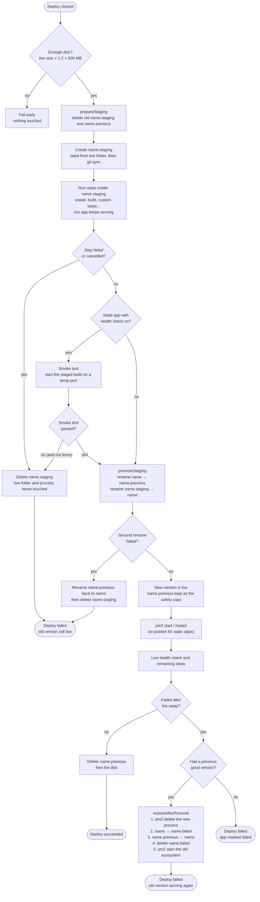
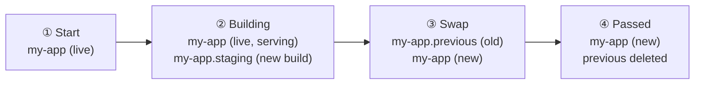

# Staged deploys

How a deploy moves between folders, and what happens when it fails. Staged deploys are on by default
(`app.stagedDeploys !== false`; turn them off per app under Overview). Source: `server/src/services/deployer.js`
(`runPipelineSteps`, `smokeAndPromote`, `restoreAfterPromote`) and `server/src/services/staging.js`.

Three sibling folders live next to the app's live folder in `APPS_DIR`. App names are `[a-z0-9-]`, so these dotted names
can never collide with another app.

| Folder | Purpose |
| --- | --- |
| `<app>` | The live version. |
| `<app>.staging` | The new version being built. The live version keeps serving meanwhile. |
| `<app>.previous` | The old live version, kept only until the deploy fully passes, as the safety copy to swap back to. |
| `<app>.failed` | Short-lived: the broken new version while the previous one is being restored. |

## Flow

## Folders over time (successful deploy)

## Notes

- **Peak disk use** is the live copy plus one more (`staging` while building, then `previous` after the swap), never
  three. `prepareStaging` clears any old `.staging` and `.previous` first.
- **The swap is two atomic renames** on one filesystem (live → previous, staging → live). If the second fails, the first
  is undone.
- **Failure before the swap** needs no rollback: the live folder and process were never touched, so the staging folder
  is just deleted.
- **Failure after the swap** swaps `.previous` back, but only when an earlier successful deploy exists. A first-ever
  deploy that fails after the swap ends up marked failed. If the restore itself fails, the deploy falls back to the
  normal failure handling (including the rebuild-based auto-rollback on a failed health check).
- **Cancelling after the swap does not swap back.** The log says the new version may already be live. Cancelling before
  it deletes the staging folder.
- **Force deploy** ignores a failed smoke test and failures in forceable steps, and promotes anyway.
- **Crash safety:** on startup the agent deletes leftover `.staging` folders from interrupted deploys, and if the swap was
  cut between its two renames (live folder missing, `.previous` present) it moves `.previous` back to live
  (`repairInterruptedSwap`).
- **Static apps** (Vite, React, plain HTML) have no process or smoke test. They go through the same folder swap, and
  the restore points the `current` release symlink back instead of restarting PM2.
